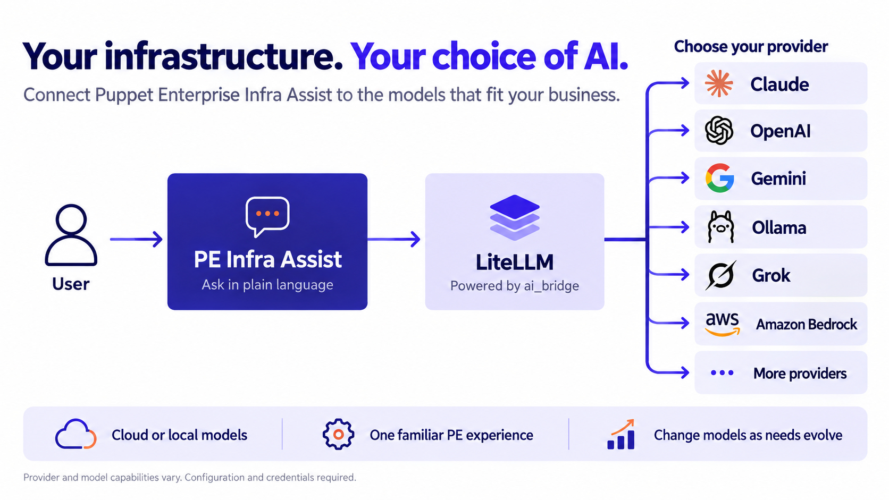

# ai_bridge

**Your infrastructure. Your choice of AI.**

#### Table of Contents

1. [Description](#description)
1. [Setup](#setup)
1. [Usage](#usage)
    - [Quick start](#quick-start)
    - [PE versions and model names](#pe-versions-and-model-names)
    - [TLS certificates](#tls-certificates)
    - [Backends](#backends)
    - [Optional compatibility settings](#optional-compatibility-settings)
1. [Reference](#reference)
1. [Limitations](#limitations)
1. [Documentation](#documentation)
1. [Development](#development)

## Description

`souldo-ai_bridge` deploys an OpenAI-compatible bridge (LiteLLM in a container) so Puppet Enterprise Infra Assistant (the PE AI Agent) can be answered by the cloud or local model that fits your business: Claude, OpenAI, Ollama, or any OpenAI-compatible server.

PE is configured with a URL and an API key and asks for a fixed OpenAI model name. The bridge accepts that name and forwards the request to the provider you choose.



This is an experimental community module. It is not a Puppet Supported product. LiteLLM is downloaded separately as an upstream container; this module's Apache-2.0 license does not relicense LiteLLM, its enterprise components, or any backend model. See the [third-party notices](https://github.com/matthewrstone/puppet-ai_bridge/blob/main/docs/THIRD_PARTY_NOTICES.md).

## Setup

### Requirements

- Puppet `>= 7.0.0 < 9.0.0` (catalog tests cover Puppet 7 and 8; Puppet 9 has been exercised in a lab only).
- Ubuntu 24.04 with Docker (the tested path). Other operating systems and the default Podman runtime need deployment validation. For the tested path use `container_runtime: docker` and `manage_package: false` with an existing Docker.
- No Puppet module dependencies.
- A TLS certificate for the bridge host that PE's console trusts (see [TLS certificates](#tls-certificates)).

### Installing

```bash
puppet module install souldo-ai_bridge
```

or add it to your Puppetfile:

```ruby
mod 'souldo-ai_bridge', '0.1.4'
```

The class is named `ai_bridge`. Prefer an agentless push? The module includes a Bolt plan; see the [Bolt deployment guide](https://github.com/matthewrstone/puppet-ai_bridge/blob/main/docs/BOLT_DEPLOYMENT.md).

## Usage

### Quick start

1. Generate a master key. This becomes PE's "API key":
   ```bash
   openssl rand -hex 32
   ```
2. Get a TLS certificate for the bridge host (see [TLS certificates](#tls-certificates)).
3. Set Hiera data, encrypting secrets with eyaml:
   ```yaml
   ai_bridge::backend: anthropic
   ai_bridge::upstream_model: claude-sonnet-4-5
   ai_bridge::upstream_api_key: ENC[PKCS7,...]
   ai_bridge::master_key: ENC[PKCS7,...]
   ai_bridge::tls_cert: |
     -----BEGIN CERTIFICATE-----
     ...
   ai_bridge::tls_key: ENC[PKCS7,...]
   ```
4. Classify the bridge host with `include ai_bridge` and run Puppet.
5. In the PE console, open **Puppet AI Agent settings**:
   - AI service: **Open AI**
   - URL: `https://<bridge-fqdn>:4000/v1`
   - API key: the master key from step 1
   - Click **Update API settings**. No red banner means success.

Switching providers means changing three Hiera keys (`backend`, `upstream_model`, and the key or URL). The [User guide](https://github.com/matthewrstone/puppet-ai_bridge/blob/main/docs/USER_GUIDE.md) has the full walk-through with Claude, OpenAI, Ollama, and Bolt examples.

### PE versions and model names

PE asks the bridge for fixed OpenAI model names, and the names differ by PE version:

| PE version | Model names requested | Bridge setting |
|------------|-----------------------|----------------|
| 2025.x | `o4-mini` | Served by default (`exposed_model`) |
| 2026.x | `gpt-5.4-mini` for chat, and `gpt-5.4` inside the PuppetDB query tool | Served by default (`manage_pe_aliases: true`) |

By default the module exposes all three names and maps each to your `upstream_model`, so one bridge serves either PE version. Set `manage_pe_aliases: false` to expose only `exposed_model`. Entries in `extra_aliases` override the defaults.

PE 2026 with Ollama also needs the two settings below. Without `tool_call_compat`, PE's PuppetDB queries can return invented answers (see [Optional compatibility settings](#optional-compatibility-settings)):

```yaml
ai_bridge::backend: ollama
ai_bridge::upstream_model: gemma4:12b
ai_bridge::upstream_base_url: http://ollama.example.net:11434
ai_bridge::ollama_think: false
ai_bridge::tool_call_compat: true
ai_bridge::normalize_usage: true
```

PE 2026 acceptance testing is incomplete: the inventory-question path has passed on one lab (PE 2026.0.0, Ubuntu 24.04, Docker, Gemma 4 12B on Ollama), but provider switching, failure handling, and PE 2025.x behavior with this release have not been fully exercised. The [release validation notes](https://github.com/matthewrstone/puppet-ai_bridge/blob/main/docs/FORGE_READINESS.md) record the evidence and remaining limits.

### TLS certificates

PE's console must trust the certificate the bridge presents. The module does not issue certificates; it takes `tls_cert` (PEM certificate or chain) and `tls_key` (PEM private key, `Sensitive`) and writes them to `<install_dir>/tls/server.crt` and `server.key`. Choose one of these:

**1. The Puppet CA (recommended).** Every PE installation has one. On the primary, issue a certificate for the bridge host's name, adding any extra DNS names you will use in the PE console URL:

```bash
puppetserver ca generate --certname ai-bridge.example.com \
  --subject-alt-names ai-bridge.example.com,ai-bridge
```

Copy the resulting certificate and private key (plus the Puppet CA certificate if you want the chain) into Hiera as `ai_bridge::tls_cert` and `ai_bridge::tls_key`. The hostname in the PE URL must match the certificate name or a subject alternative name. Confirm that PE's console trusts the Puppet CA in your environment before relying on it (see the check below).

**2. A publicly trusted certificate**, such as one from ACME/Let's Encrypt. This needs a public DNS name for the bridge host.

**3. An external TLS-terminating proxy.** Set `manage_tls: false` so the bridge listens on plain HTTP, and put a proxy you already run in front of it. Use the proxy's HTTPS URL in PE and keep the bridge's plain-HTTP port on a private network only.

A certificate from an internal CA works too, provided PE trusts that CA. Verify trust from the PE primary with `curl` (without `-k`) before saving in the console. If PE reports `PKIX path building failed`, see the [Troubleshooting guide](https://github.com/matthewrstone/puppet-ai_bridge/blob/main/docs/TROUBLESHOOTING.md).

### Backends

| `backend` | `upstream_model` example | Needs | Notes |
|-----------|--------------------------|-------|-------|
| `anthropic` | `claude-sonnet-4-5` | `upstream_api_key` | LiteLLM translates tool calls, system prompts, streaming |
| `openai` | `gpt-5-mini` | `upstream_api_key` | Pure rename; lowest format risk |
| `ollama` | `qwen3:32b` | `upstream_base_url` (`http://host:11434`) | Uses `ollama_chat/` so tool calling works. Pick a tool-capable model |
| `openai_compatible` | `Qwen/Qwen3-32B` | `upstream_base_url` (`http://host:8000/v1`), optional key | vLLM, LM Studio, llama.cpp, TGI, PAG |

Compilation fails with a clear message if `upstream_api_key` is missing for anthropic/openai, `upstream_base_url` is missing for ollama/openai_compatible, or `tls_cert`/`tls_key` are missing while `manage_tls` is true.

### Optional compatibility settings

All default to off (or unset) except `manage_pe_aliases`. Enable only what your PE and model need.

- **`tool_call_compat`**: PE's PuppetDB tool sends a tool definition and a strict JSON-schema response format in the same request. Some local models (observed with Gemma on Ollama) then fill in the schema directly and never call the tool, producing an invented answer. This setting withholds the schema until a tool result is present, so the model can call the tool; the schema is restored for the final answer.
- **`normalize_usage`**: enable when PE throws a null-pointer exception in `ConversationService.finalizeAssistantMessage` for missing token-usage detail objects. It adds zero defaults for missing detail fields and leaves aggregate counts and content unchanged. The zeros are compatibility values, not measured statistics.
- **`ollama_think`**: set `false` to turn off model "thinking" on Ollama models and aliases when replies come back empty or time out; leave unset to keep the upstream default. It applies only to `ollama_chat/` models.
- **`personality_prompt`**: response style text appended to chat system instructions, for example `'Talk like a pirate'`. It is a style instruction, not an access-control mechanism.
- **`debug`**: sets `LITELLM_LOG=DEBUG`, which logs prompts and tool results. Use it for troubleshooting only and turn it off afterwards.

## Reference

The full parameter list, types, defaults, and data types are in [REFERENCE.md](https://github.com/matthewrstone/puppet-ai_bridge/blob/main/REFERENCE.md). The most commonly set parameters:

| Parameter | Default | Purpose |
|-----------|---------|---------|
| `master_key` | none (required) | Bearer token PE presents; paste into PE's API key field (`Sensitive`) |
| `backend` / `upstream_model` | `anthropic` / `claude-sonnet-4-5` | Provider and its model name |
| `upstream_api_key` / `upstream_base_url` | `undef` | Provider credentials or URL (required per backend) |
| `exposed_model` | `o4-mini` | Primary name PE asks for |
| `manage_pe_aliases` | `true` | Also serve `gpt-5.4-mini` and `gpt-5.4` |
| `extra_aliases` | `{}` | More `{name => 'provider/model'}` entries; override the defaults |
| `tool_call_compat` | `false` | Let tool-using models call tools under a JSON-schema request |
| `container_runtime` | `podman` | `podman` or `docker`; Docker is the tested path |
| `image` | `ghcr.io/berriai/litellm:main-stable` | Pin a digest in production |
| `listen_port` | `4000` | Listener port |
| `request_timeout` | `300` | Seconds; raise for slow local models |

## Limitations

- Experimental community release; not a Puppet Supported product.
- Tested on Ubuntu 24.04 with Docker. The Podman path and other operating systems are untested.
- PE acceptance is partial; see [PE versions and model names](#pe-versions-and-model-names).
- Model quality is the provider's: small local models can misread tool results or ignore instructions even with the compatibility settings on.
- The bridge relies on LiteLLM's request translation. Pin the container image to a reviewed digest in production.

## Documentation

All guides are in the [project repository](https://github.com/matthewrstone/puppet-ai_bridge/tree/main/docs) and ship inside the module package under `docs/`:

- [ELI10](https://github.com/matthewrstone/puppet-ai_bridge/blob/main/docs/ELI10.md): the plain-language explanation
- [User guide](https://github.com/matthewrstone/puppet-ai_bridge/blob/main/docs/USER_GUIDE.md): step-by-step setup and day-2 operations
- [Bolt deployment](https://github.com/matthewrstone/puppet-ai_bridge/blob/main/docs/BOLT_DEPLOYMENT.md): agentless deployment
- [Troubleshooting](https://github.com/matthewrstone/puppet-ai_bridge/blob/main/docs/TROUBLESHOOTING.md): symptoms and fixes
- [Security](https://github.com/matthewrstone/puppet-ai_bridge/blob/main/docs/SECURITY.md): threat model and hardening
- [Human UAT](https://github.com/matthewrstone/puppet-ai_bridge/blob/main/docs/UAT_HUMAN_TESTING.md): tests that need a person and a real PE
- [Design](https://github.com/matthewrstone/puppet-ai_bridge/blob/main/docs/DESIGN.md): why it is built this way
- [Release validation](https://github.com/matthewrstone/puppet-ai_bridge/blob/main/docs/FORGE_READINESS.md): release gates and test commands

## Development

Source, issues, the `pe-capture` tool (records exactly what PE sends), a standalone LiteLLM compose example, and the test suite live in the [GitHub repository](https://github.com/matthewrstone/puppet-ai_bridge). See [DEVELOPMENT.md](https://github.com/matthewrstone/puppet-ai_bridge/blob/main/docs/DEVELOPMENT.md) for running the tests.

Licensed under [Apache-2.0](https://github.com/matthewrstone/puppet-ai_bridge/blob/main/LICENSE).
