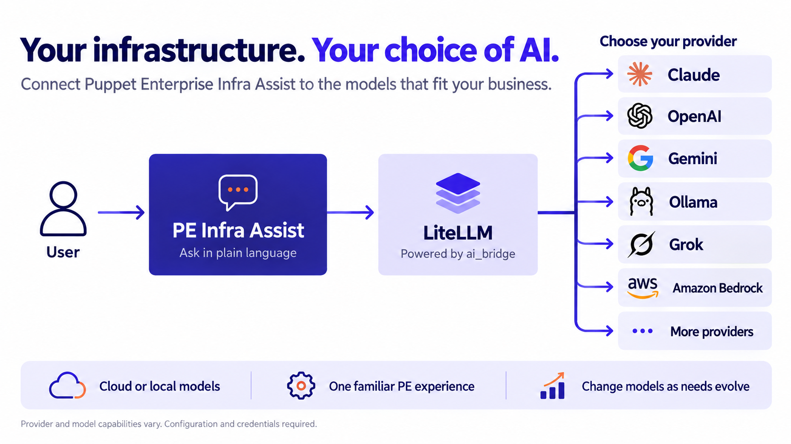

# puppet-ai_bridge

**Your infrastructure. Your choice of AI.**

Connect Puppet Enterprise Infra Assist to the cloud or local models that fit your
business, using LiteLLM as an OpenAI-compatible bridge.



[Download the slide-ready graphic](docs/images/pe-llm-choice.png) ·
[Graphic notes](docs/images/README.md)

`ai_bridge` connects PE Infra Assist to your chosen cloud or local model through
LiteLLM. [Deploy with Bolt](docs/BOLT_DEPLOYMENT.md), with Docker already installed
or installed by the plan.

## Contents

| Path | What |
|------|------|
| `manifests/`, `templates/`, `types/` | Puppet module `souldo-ai_bridge` |
| `tools/pe-capture/` | Go tool that records exactly what PE sends (and can act as a minimal bridge itself) |
| `litellm/` | Standalone `docker-compose.yml` + reference `config.yaml` for testing without Puppet |
| `docs/` | [ELI10](docs/ELI10.md) · [User guide](docs/USER_GUIDE.md) · [Human UAT](docs/UAT_HUMAN_TESTING.md) · [Security](docs/SECURITY.md) · [Design](docs/DESIGN.md) · [Troubleshooting](docs/TROUBLESHOOTING.md) |
| `.planning/` | GSD project plan, roadmap and state |

## Quick start (Puppet)

1. Generate a master key — this becomes PE's "API key":
   ```sh
   openssl rand -hex 32
   ```
2. Get a TLS cert for the bridge host from your CA (Step CA example):
   ```sh
   step ca certificate ai-bridge.souldo.lan server.crt server.key
   ```
3. Hiera (eyaml-encrypt the secrets):
   ```yaml
   ai_bridge::backend: anthropic
   ai_bridge::upstream_model: claude-sonnet-4-5
   ai_bridge::upstream_api_key: ENC[PKCS7,...]
   ai_bridge::master_key: ENC[PKCS7,...]
   ai_bridge::tls_cert: |
     -----BEGIN CERTIFICATE-----
     ...
   ai_bridge::tls_key: ENC[PKCS7,...]
   ```
4. Classify the host with `include ai_bridge`, run Puppet.
5. In the PE console → **Puppet AI Agent settings**:
   - AI service: **Open AI**
   - URL: `https://ai-bridge.souldo.lan:4000/v1`
   - API key: the master key from step 1
   - **Update API settings** → no red banner.

Switch backends by changing three Hiera keys. See `examples/` for Claude, OpenAI and Ollama.

## Backends

| `backend` | `upstream_model` example | Needs | Notes |
|-----------|--------------------------|-------|-------|
| `anthropic` | `claude-sonnet-4-5` | `upstream_api_key` | LiteLLM translates tool calls, system prompts, streaming |
| `openai` | `gpt-5-mini` | `upstream_api_key` | Pure rename; lowest format risk |
| `ollama` | `qwen3:32b` | `upstream_base_url` (`http://host:11434`) | Uses `ollama_chat/` so tool calling works. Pick a tool-capable model |
| `openai_compatible` | `Qwen/Qwen3-32B` | `upstream_base_url` (`http://host:8000/v1`), optional key | vLLM, LM Studio, llama.cpp, TGI, PAG |

## Parameters

| Parameter | Type | Default | Purpose |
|-----------|------|---------|---------|
| `master_key` | `Sensitive[String]` | — (required) | Bearer token PE presents. Paste into PE's API key field |
| `backend` | `Ai_bridge::Backend` | `anthropic` | Provider |
| `upstream_model` | `String` | `claude-sonnet-4-5` | Provider-side model name |
| `upstream_api_key` | `Optional[Sensitive[String]]` | `undef` | Provider key (required for anthropic/openai) |
| `upstream_base_url` | `Optional[Ai_bridge::Url]` | `undef` | Provider URL (required for ollama/openai_compatible) |
| `exposed_model` | `String` | `o4-mini` | Name PE asks for |
| `extra_aliases` | `Hash[String,String]` | `{}` | More `{name => 'provider/model'}` entries |
| `listen_port` | `Ai_bridge::Port` | `4000` | Listener port |
| `manage_tls` | `Boolean` | `true` | Terminate TLS in the bridge |
| `tls_cert` / `tls_key` | `String` / `Sensitive[String]` | `undef` | PEM contents (required when `manage_tls`) |
| `container_runtime` | `podman`/`docker` | `podman` | Podman runs rootless as `ai_bridge` |
| `image` | `String` | `ghcr.io/berriai/litellm:main-stable` | Pin a digest in prod |
| `install_dir` | path | `/opt/ai_bridge` | Config/env/TLS location |
| `drop_params` | `Boolean` | `true` | Strip params the provider rejects (reasoning_effort etc.) |
| `request_timeout` | `Integer` | `300` | Seconds; raise for slow local models |
| `debug` | `Boolean` | `false` | `LITELLM_LOG=DEBUG` — logs prompts, troubleshooting only |
| `ensure` | `present`/`absent` | `present` | `absent` removes everything |

## Capturing what PE really sends

Before trusting any config, run `pe-capture` for one console save and read `capture.jsonl`:

```sh
cd tools/pe-capture && go build .
./pe-capture -listen :4000 -cert server.crt -key server.key -log capture.jsonl
# point PE at https://<host>:4000/v1 with any API key, click Update API settings
jq . capture.jsonl
```

It answers `/v1/models` and `/v1/chat/completions` convincingly enough for the console's validation to pass, and logs headers (credentials redacted) and bodies. Add `-upstream https://api.openai.com -upstream-key $OPENAI_API_KEY -rewrite-model o4-mini=gpt-5-mini` and it *is* a zero-dependency bridge for the OpenAI→OpenAI case.

## Testing

```sh
cd tools/pe-capture && go test -race -cover ./...     # Go
pdk validate && pdk test unit                          # Puppet (or: bundle exec rake spec)
```

## Status

Built TDD, all tests green. Not yet pointed at a real PE — see `.planning/STATE.md` and `docs/UAT_HUMAN_TESTING.md`.

## License

Apache-2.0

## PE 2026 compatibility

PE versions can request different model names. In the PE 2026 lab, requests used
`gpt-5.4-mini`; configure an explicit alias while retaining the default `o4-mini`:

```yaml
ai_bridge::backend: ollama
ai_bridge::upstream_model: gemma4:12b
ai_bridge::upstream_base_url: http://ollama.example.net:11434
ai_bridge::extra_aliases:
  gpt-5.4-mini: ollama_chat/gemma4:12b
ai_bridge::normalize_usage: true
```

`normalize_usage` defaults to `false`. Enable it when PE throws a null-pointer
exception in `ConversationService.finalizeAssistantMessage` for missing token
usage detail objects. It adds missing/null prompt and completion detail fields
with zero defaults, preserving aggregate token counts, supplied detail counts,
and response content. These defaults are compatibility values, not measured
cache/audio/reasoning statistics. Responses without usage remain unchanged.
The callback and its helpers are mounted read-only and loaded through `/app`.

With Docker, bind-mounted configuration/TLS files are root-owned so the container
can read them with all Linux capabilities dropped. Secrets remain mode `0600`;
Podman uses the configured service account as before.

Lab evidence: Ubuntu 24.04, Puppet 9.1.1, LiteLLM 1.106.6 and Gemma 4 12B.
The PE API recorded response finalization after enabling this workaround.
Visible clearing of the console's “Thinking” indicator remains unverified;
previously stuck conversations may need a fresh chat. Puppet 9 is lab evidence,
not yet an expanded published support requirement.

Run pure Python tests with `python3 -m unittest discover -s tests -p test_pe_usage.py`.
Runtime callback tests require the pinned LiteLLM environment; see
[Forge readiness](docs/FORGE_READINESS.md) for commands and remaining release gates.
