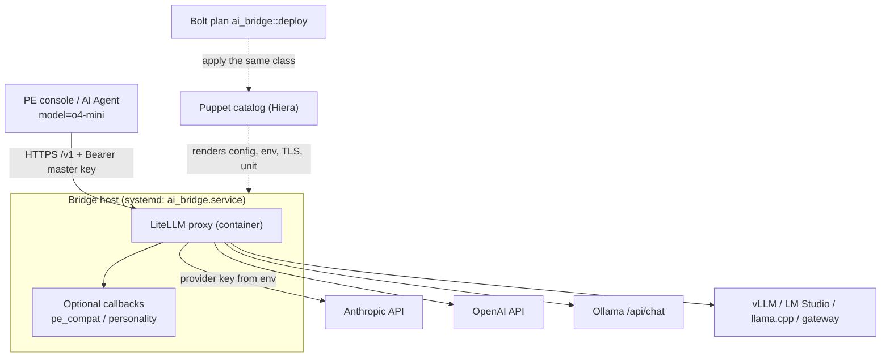

<!-- generated-by: gsd-doc-writer -->
# Architecture

> **PE version note:** this document describes PE 2025.x, which hard-codes `o4-mini`. PE 2026.x also requests `gpt-5.4-mini` and `gpt-5.4` (the latter inside its PuppetDB tool, which sends tools together with a JSON-schema response format). The module serves those names by default (`manage_pe_aliases`) and offers `tool_call_compat` for the schema/tool interaction.

This document describes how the `souldo-ai_bridge` module is put together and how a request travels through it. For the original problem statement and design rationale, see [DESIGN.md](DESIGN.md). For operating the bridge, see [USER_GUIDE.md](USER_GUIDE.md) and [TROUBLESHOOTING.md](TROUBLESHOOTING.md).

## System overview

`ai_bridge` is a Puppet module that deploys an OpenAI-compatible HTTPS service in front of a real LLM provider, so that the Puppet Enterprise (PE) AI Agent can keep asking for the hard-coded model name `o4-mini` while a different model answers. The service is a LiteLLM proxy running in a container (Podman by default, Docker optionally) under a systemd unit. PE's only operator-controllable inputs are a base URL and a bearer token; the bridge accepts both, authenticates the bearer, renames `o4-mini` to the configured provider model, translates the request to the provider's API (Anthropic, OpenAI, Ollama, or any OpenAI-compatible server), and returns an OpenAI-shaped response. Architecturally it is a configuration-driven reverse proxy with a thin, declarative Puppet layer that renders files and a systemd unit, and two optional in-process Python callbacks for PE-specific quirks. The bridge is stateless: it has no database, no UI, and no spend logging.

## Component diagram



Solid arrows are runtime request flow. Dashed arrows are deployment-time configuration. The `tools/pe-capture` Go utility is a standalone diagnostic and is deliberately not part of the runtime path (see [Directory structure rationale](#directory-structure-rationale)).

### Puppet class layout

One public class (`ai_bridge`) owns all parameters and validation. Three private classes (`@api private`) do the work.

| Class | File | Responsibility |
|-------|------|----------------|
| `ai_bridge` | `manifests/init.pp` | Parameters, compile-time validation, derivation of the LiteLLM model string and key env var name, ordering |
| `ai_bridge::install` | `manifests/install.pp` | System group and user (`nologin`), optional container runtime package, `install_dir` and `install_dir/tls` (0750), sub-UID/sub-GID range for rootless Podman |
| `ai_bridge::config` | `manifests/config.pp` | `ai_bridge.env` (0600, `Sensitive`), `config.yaml` (0640), optional `pe_compat.py`/`pe_usage.py`, optional `personality.*` files, `tls/server.crt` and `tls/server.key` |
| `ai_bridge::service` | `manifests/service.pp` | `/etc/systemd/system/ai_bridge.service`, `systemctl daemon-reload` exec, the `ai_bridge` service |

Ordering when `ensure => present`: `install -> config ~> service`, so a change to any rendered file restarts the service. When `ensure => absent` the order reverses (`service -> config`): the service is stopped and the unit is removed before `install_dir` is deleted. The container runtime package and the service user are left in place on removal.

## Data flow

### Request path

1. PE sends `POST /v1/chat/completions` (and `/v1/models` during console validation) to `https://<bridge>:<listen_port>/v1` with `Authorization: Bearer <master_key>` and `model: "o4-mini"`.
2. TLS is terminated inside the LiteLLM container using `/app/tls/server.crt` and `/app/tls/server.key` (bind-mounted read-only from `install_dir/tls`) when `manage_tls` is true.
3. LiteLLM compares the bearer with `LITELLM_MASTER_KEY` (`general_settings.master_key: os.environ/LITELLM_MASTER_KEY`) and rejects the request if it does not match.
4. If the personality callback is enabled, its `async_pre_call_hook` appends the configured response-style text to the request's system message before the provider call (see [Optional callbacks](#optional-callbacks)).
5. LiteLLM looks up `model_name: o4-mini` (or the value of `exposed_model`) in `model_list` and resolves it to a provider-prefixed model such as `anthropic/claude-sonnet-4-5`. With `drop_params: true`, request parameters the provider does not support (for example `reasoning_effort`) are dropped instead of causing an error.
6. LiteLLM translates the request to the provider's API, using the provider key from the process environment (`api_key: os.environ/<KEY_ENV>`) and `api_base` when one is configured, and calls the provider (one retry, `request_timeout` seconds).
7. The provider response is translated back to the OpenAI chat-completion shape, including streaming chunks. If the usage-normalization callback is enabled, its post-call hooks fill missing `prompt_tokens_details` and `completion_tokens_details` fields with zeros for both full and streamed responses.
8. The response returns to PE over the same TLS connection.

### Lifecycle of a secret

Secrets enter as Hiera (eyaml) values and reach the container only through an env file:

```
Hiera (eyaml) -> Sensitive[String] class parameter
  -> .unwrap inside the epp() call in ai_bridge::config
  -> Sensitive($env_content) as file content
  -> <install_dir>/ai_bridge.env (0600, show_diff => false)
  -> --env-file in the systemd ExecStart line
  -> container process environment
  -> LiteLLM resolves os.environ/<NAME> references in config.yaml
```

`config.yaml` therefore contains only `os.environ/...` references, never key values, and no secret appears on the container command line. `tls_key` is written separately to `tls/server.key` (0600, `show_diff => false`). The Puppet catalog itself still contains these values, as with any Puppet-managed secret; see [SECURITY.md](SECURITY.md).

### TLS termination and certificate trust

By default the bridge terminates TLS itself (`manage_tls: true`). PE's console must trust the certificate the bridge presents, or saving the provider settings fails with a PKIX/certification-path error (see [TROUBLESHOOTING.md](TROUBLESHOOTING.md)). The module does not issue certificates; `tls_cert` and `tls_key` are inputs.

Options, in order of preference for a typical PE site:

1. **Puppet CA (default).** Issue the bridge's server certificate from PE's own Puppet CA (for example `puppetserver ca generate --certname <bridge-fqdn>` on the primary), so the bridge's certificate chains to the same CA that PE already uses for its own services. This avoids importing anything into PE. <!-- VERIFY: which truststore the PE console/AI Agent JVM uses for outbound HTTPS, and that it includes the Puppet CA by default; this cannot be confirmed from the repository -->
2. **A public CA.** A certificate for the bridge's public DNS name issued by a CA that the PE host's Java runtime already trusts needs no extra trust configuration. <!-- VERIFY: that PE's JVM falls back to the default Java cacerts for outbound connections -->
3. **An external TLS proxy.** Set `manage_tls: false`, terminate TLS on a reverse proxy or load balancer you already operate, and give PE that proxy's HTTPS URL. The bridge then listens on plain HTTP on `listen_port` and must be reachable only from the proxy.
4. **An internal CA** works the same way as option 2 provided PE trusts it; importing that CA into PE's truststore is the extra step. This is an aside, not a requirement.

`manage_tls: false` without an external proxy leaves plain HTTP on the bridge port and is intended for isolated lab use only.

## Key abstractions

| Abstraction | Location | Purpose |
|-------------|----------|---------|
| `ai_bridge` class | `manifests/init.pp` | Single public interface. A `backend` switch selects the provider, so changing provider is a data (Hiera) change, not a classification change |
| `Ai_bridge::Backend` | `types/backend.pp` | `Enum['anthropic', 'openai', 'ollama', 'openai_compatible']` |
| `Ai_bridge::Port`, `Ai_bridge::Url`, `Ai_bridge::Absolutepath` | `types/*.pp` | Local type aliases replacing `puppetlabs-stdlib` types, so the module has no dependencies (`metadata.json` lists none) |
| Provider model mapping | `manifests/init.pp` (`$provider_model`, `$key_env`) | Maps a backend to a LiteLLM model string (`anthropic/`, `openai/`, `ollama_chat/`, `openai/` for OpenAI-compatible) and to the env var name holding the key (`ANTHROPIC_API_KEY`, `OPENAI_API_KEY`, `UPSTREAM_API_KEY`; none for Ollama) |
| Compile-time validation | `manifests/init.pp` | `fail()` for missing `upstream_api_key` (anthropic/openai), missing `upstream_base_url` (ollama/openai_compatible), and missing `tls_cert`/`tls_key` with TLS on |
| EPP templates | `templates/config.yaml.epp`, `ai_bridge.env.epp`, `ai_bridge.service.epp` | Render the LiteLLM config, the secrets env file, and the systemd unit that wraps `podman run` / `docker run` directly |
| `pe_compat.PEUsageCompatibility` | `files/pe_compat.py` | LiteLLM `CustomLogger` that normalizes usage objects on responses and streamed chunks |
| `pe_usage.normalize_usage` | `files/pe_usage.py` | Pure function that fills unreported usage detail fields with zero; does not alter aggregate counts |
| `personality.PersonalityStyle` / `styled_messages` | `files/personality_callback.py`, `files/personality.py` | Pre-call hook that appends response-style text to the system message, or inserts one if none exists; idempotent |
| `ai_bridge::deploy` plan | `plans/deploy.pp` | Bolt plan: runs the runtime task, `apply_prep`, then applies the same class with `container_runtime => docker` and `manage_package => false` |
| `ai_bridge::docker_runtime` task | `tasks/docker_runtime.py`, `tasks/docker_runtime.json` | Checks the Docker daemon; installs `docker.io` only when explicitly requested on Ubuntu 22.04/24.04 or Debian 12 |

### Runtime hardening in the unit file

`templates/ai_bridge.service.epp` starts the container with `--read-only --tmpfs /tmp --cap-drop=ALL --security-opt=no-new-privileges`, mounts config and TLS read-only (`:ro,Z`), and publishes only `listen_port`. With Podman the unit runs as the `ai_bridge` user (rootless); with Docker it runs as root because the Docker daemon socket requires it, and the managed files are then owned by root so the container can read the bind mounts.

### Optional callbacks

Two opt-in LiteLLM callbacks live in `files/` and are copied into `install_dir` and bind-mounted into the container only when enabled. When either is enabled the unit sets `PYTHONPATH=/app` and `config.yaml` registers the handlers under `litellm_settings.callbacks`.

| Callback | Enabled by | Effect |
|----------|------------|--------|
| `pe_compat.proxy_handler` | `normalize_usage: true` | Prevents PE null dereferences when an upstream omits usage detail objects; zeros are compatibility defaults, not measured counts |
| `personality_callback.proxy_handler` | `personality_prompt` set | Appends operator-selected style text to the system message with a notice that it grants no permissions; the text is read from a read-only `personality.txt` |

When `personality_prompt` is unset, the module explicitly removes any previously deployed `personality.*` files.

## Directory structure rationale

```
manifests/    Public class and the three private classes (install, config, service)
types/        Local type aliases that replace stdlib types
templates/    EPP templates: LiteLLM config, env file, systemd unit
files/        Python callbacks and helpers shipped to the bridge host
data/         Module-level Hiera defaults (secrets deliberately have none)
hiera.yaml    Module data hierarchy (v5, yaml_data)
plans/        Bolt plan for standalone deployment
tasks/        Bolt task that checks or installs the Docker runtime
litellm/      Standalone reference config and docker-compose for testing without Puppet
examples/     Example Hiera data per backend, Bolt project and inventory, sample class usage
tools/        pe-capture: Go diagnostic that records what PE sends (also a minimal forwarder)
spec/         RSpec catalog tests for the Puppet class
tests/        Python unit/runtime tests and the Bolt plan spec
docs/         User, security, deployment, and design documentation
```

- `data/common.yaml` supplies defaults for non-secret parameters only. `master_key`, `upstream_api_key`, and `tls_key` have no defaults, so a catalog fails to compile until they are supplied.
- `litellm/` mirrors what the module generates and is for quick manual testing; the compose file can optionally run `pe-capture` as a tap in front of the bridge under the `capture` profile.
- `tools/pe-capture` is a ~700-line Go program (including tests) with no runtime role in the module. It answers `/v1/models` and `/v1/chat/completions` with valid shapes, logs requests as JSONL with credentials redacted, and can forward to an upstream with model rewriting. It exists to find out what PE actually sends.
- The `litellm/tls/` and `litellm/capture/` directories are placeholders (`.gitkeep`) for local testing material.

## Design constraints worth knowing

- **No module dependencies.** The module avoids `puppetlabs-stdlib` and `puppetlabs-docker` so it can be dropped into any control repository.
- **LiteLLM rather than hand-rolled translation.** Tool-call and streaming translation across providers is delegated to LiteLLM; callback API compatibility should be re-checked whenever `image` is changed (see [FORGE_READINESS.md](FORGE_READINESS.md)).
- **One configuration owner.** The Bolt plan and a PE classification should not both manage the same bridge with different settings (see [BOLT_DEPLOYMENT.md](BOLT_DEPLOYMENT.md)).
- **Firewalling and DNS are out of scope.** The module does not manage them; restrict `listen_port` to PE yourself.
